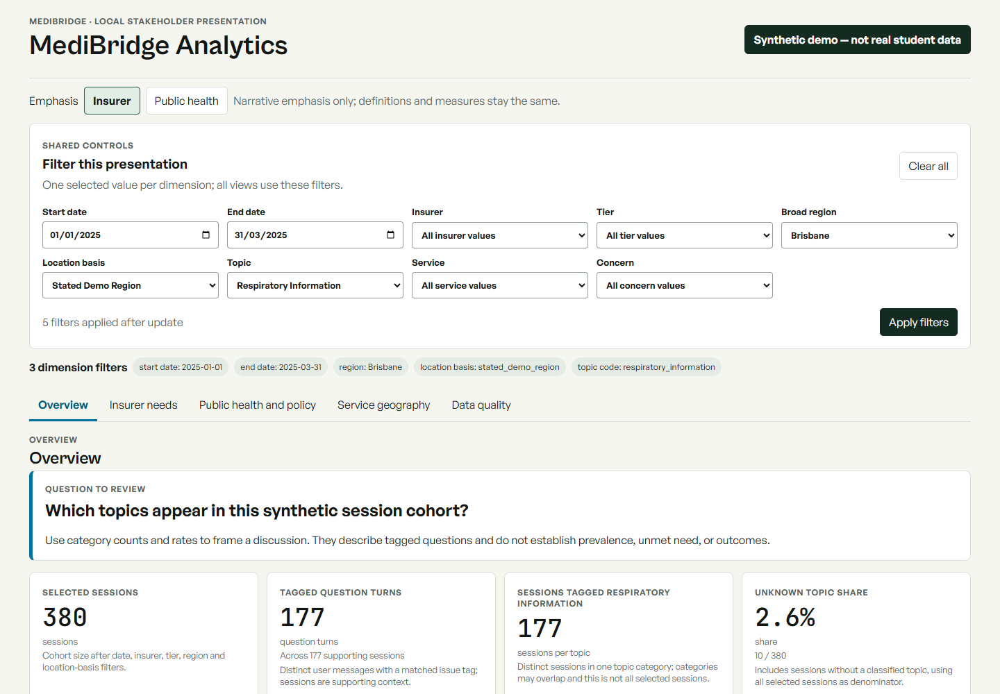
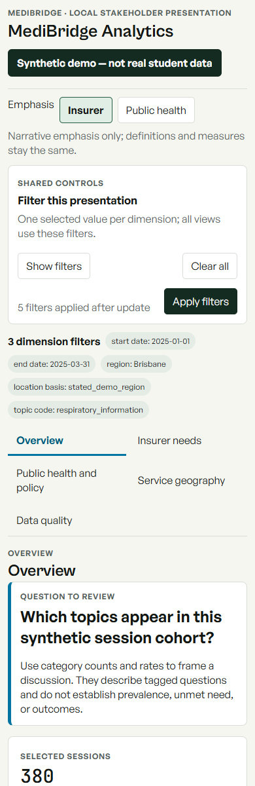
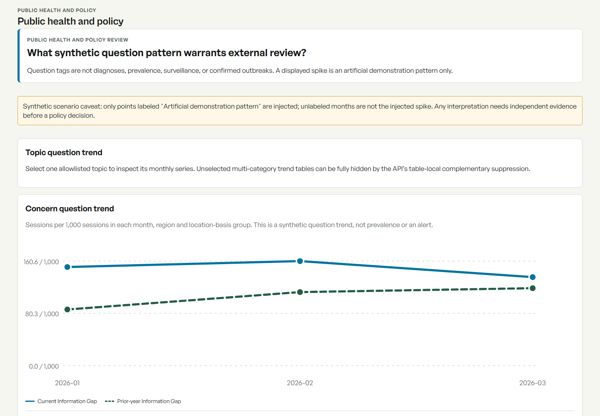

# Phase 3 Dashboard Validation Record

**Branch:** `phase3-dashboard-design` (from `phase2-analytics-api`)
**Visual direction:** Option B, Question-to-decision, selected by the project owner.
**Data:** Local generated synthetic store only; no participant data or live student conversations.

## Implementation and API fidelity

The dashboard is a separate React entry point in `analytics_ui/`, built to `src/medibridge/analytics_demo/static/` and served by the Phase 2 FastAPI app at `/dashboard/` and `/dashboard/assets/`. The standalone API runner binds to `127.0.0.1`; the student application in `ui/`, mobile artwork and Capacitor web/native outputs were not edited. The client calls only the allowlisted `/api/demo/{meta,overview,topics,trend,regions,coverage-friction,quality}` aggregate endpoints.

The UI displays the disclosure **Synthetic demo — not real student data** on every view. It never requests or shows raw transcript/message text, person/session IDs, row-level data, or individual paths; there is no export, map, or individual drilldown. Fully hidden tables say values are hidden; partially suppressed tables retain available values and identify hidden siblings; valid empty responses are distinct from suppression, and zeroes are not substituted for nulls. Provenance is read from the API, including `issue-taxonomy-v1`; the mockup's `demo-topic-taxonomy-v1` is not authoritative.

Two implementation rulings preserve the Phase 2 contract:

- Filter dimensions are single-select because the API rejects repeated values for a dimension. Values, including unknowns, come from the exact `/meta` allowlist; for example `topic_code=unknown_unclassified`, `region=unknown`, and `location_basis=unknown`.
- A trend requires one selected topic or concern, one broad region, and a known location basis. It indexes series by the selected dimension (`topic_code` or `concern_code`). Each monthly rate uses that period/region/basis group's sessions as its denominator; unknown region or basis is excluded. The chart is a line time series with distinct current and returned same-month prior-year lines. Visible monthly text and its accessible table include each series' numerator, denominator and rate, plus `rate_difference_per_1000`; the UI states when a baseline is unavailable and breaks lines over suppressed or missing values. The weekly bucket has no baseline. Without a selected series, the UI explains that unselected trend cells may all be hidden by the API's conservative table-local complementary suppression. Invalid `view` URL values fall back to Overview. The policy-view banner says only labeled points are injected; other displayed synthetic values do not inherit the spike label.

Chart values have direct labels and an adjacent, expandable aggregate table. Bars are native keyboard-operable buttons; table sorting is a native keyboard-operable button. All five views share date, insurer, tier, region, location-basis, topic, service and concern filters. At 390px the filters start collapsed behind a labelled control, the five view tabs wrap into a visible two-column menu, metric cards stack, wide tables scroll within labelled regions with a visible instruction, and long trend axes show at most five month labels while retaining every month in the text alternative.

## Commands and results

Commands were run from the repository root unless a working directory is named.

| Command | Result |
|---|---|
| `npm ci` (in `mobile/`) | Completed. Environment Node was `v25.5.0`; Node 22 from the plan was not installed on this workstation (`nvm` listed Node 20.20.2 and 25.5.0). npm reported 8 existing audit advisories (3 moderate, 4 high, 1 critical); none were auto-fixed. |
| `npm run build:analytics` (in `mobile/`; implemented as `node scripts/build-analytics.mjs`) | Passed after the time-series chart and scenario-caveat refinements. Built the separate dashboard bundle and copied its self-hosted fonts and shell to package static assets; bundle was 172.4 KB. |
| `node --test tests/frontend/*.test.mjs` | Passed: 18 tests, 0 failures. Includes topic/concern dimensions, baseline/delta fields, gaps at missing/suppressed line points, responsive sparse tick selection, partial/full suppression, and invalid-view fallback. |
| `.\.venv\Scripts\python.exe -m pytest tests/ -q` | Passed: 130 passed, 1 skipped, 1 existing `chromadb` deprecation warning, in 6.19 seconds. |
| `.\.venv\Scripts\python.exe -m medibridge.analytics_demo.generate --output data/analytics_demo.sqlite --seed 20261005 --sessions 50000` | Generated local ignored synthetic data: 50,000 sessions, 200,000 messages, 53,533 issue events. The SQLite file is not committed. |
| `.\.venv\Scripts\python.exe -m medibridge.analytics_demo.validate data/analytics_demo.sqlite` | Passed: `ok: true`, 0 errors; validator SHA-256 `0b28b78fac6f833acd9e3b75548ae08fb806c61fd1b780521f3b62a0b9abb165`. |
| `npm exec --yes --package=playwright -- playwright --version` | Passed: Playwright 1.63.0 used with the workstation's installed Chrome. Temporary local smoke scripts were used; Playwright was not added to project dependencies. |
| `node $env:TEMP\medibridge-dashboard-browser-check.mjs` | Passed: all five views rendered with their synthetic disclosure; ArrowRight moved between tabs; narrow filters collapsed; all five views remained visible; document/body width was 390px at a 390px viewport; chart alternative and table captions were present; no page or console errors. |
| `node $env:TEMP\medibridge-dashboard-regression-browser.mjs` | Passed: `concern_code=information_gap` rendered distinct current and prior-year SVG lines; its visible monthly text and table included both numerators, denominators and rates plus the `+65.2 / 1,000` difference; the respiratory scenario retained its point label and explicitly unavailable baseline; the ordinary 2026 concern view used a neutral caveat and had no injected-point label; an invalid view fell back to Overview; no browser page errors. |
| `node $env:TEMP\medibridge-dashboard-long-trend.mjs` | Passed: the 24-month series showed 12 desktop axis labels and 5 labels at 390px, including first and last month; all 24 months remained in the text alternative; no narrow overflow or browser errors. |
| `node $env:TEMP\medibridge-dashboard-state-check.mjs` | Passed: all five views rendered dense, sparse, and empty fixture-backed response states (15 view/state combinations). |
| `node $env:TEMP\medibridge-dashboard-interactions.mjs` | Passed: Enter on a ranked bar applied its topic filter; Enter on the table sort button changed sort direction; a sparse full-store selection rendered “Insufficient group size” rather than zero; an empty selection rendered its distinct no-data explanation. |

The first browser pass exposed a missing chart table import and a narrow-screen filter/navigation issue; both were corrected before the passing browser run and screenshots below. Review then exposed four regressions, fixed and covered by the follow-up tests. The chart's trend table is collapsed by default so a long date range does not overwhelm the presentation canvas.

## Scripted synthetic walkthroughs

These are scripted inspections of generated aggregates, not participant interviews or user acceptance findings.

1. **Insurer reviewing coverage confusion.** With the full available date span and filters `region=Brisbane&location_basis=stated_demo_region`, `/api/demo/coverage-friction` returns 146 synthetic sessions tagged with waiting-period questions, 122 with coverage-benefit/exclusion questions, and 51 with out-of-pocket-cost questions. Categories can overlap, so they are not summed as a partition or market share. The view supports a discussion prompt about where synthetic questions ask about waiting periods versus exclusions; its visible caveat says the endpoint does not measure claims friction or actual coverage failures.
2. **Health-department analyst inspecting a respiratory pattern.** With `start_date=2025-01-01&end_date=2025-03-31&region=Brisbane&location_basis=stated_demo_region&topic_code=respiratory_information`, `/api/demo/trend?bucket=month` returns January 71/139 (510.8 per 1,000), February 51/115 (443.5 per 1,000), and March 55/126 (436.5 per 1,000). These are rates within each selected month/region/basis group. The API has no matching prior-year January–March cells in the selected source span, so the UI does not invent a baseline. The chart and view label the pattern artificial and require external evidence before a policy interpretation; it is not prevalence, surveillance, or an outbreak signal.

## Browser screenshots and accessibility check

The desktop and narrow screenshots were captured after aggregate requests settled, at 1440×1000 and 390×1200 CSS pixel viewports, using the respiratory-topic selection described in the second walkthrough. The trend-detail capture shows distinct current and prior-year lines for a selected synthetic concern; monthly text and the expandable table beneath the graph provide counts, denominators, rates and differences.

Keyboard checks covered tab navigation, ranked-bar selection and table sorting. Chart series have an accessible text summary and an adjacent expandable table with a caption; the table includes prior-year numerator, denominator, rate and rate-difference columns when available. All values and suppression status are directly labelled rather than available only in hover tooltips. The 390px browser check found no page-level horizontal overflow. Contrast is encoded with text and status labels as well as color; no automated WCAG contrast audit was run.

## Feedback and remaining governance gate

No participating insurers, health-department analysts, or student representatives were supplied for review. No questionnaire IDs received feedback, and no participant walkthrough or endorsement is claimed. Owner-directed Option B implementation is ready for owner review, but the narrative, labels and interaction choices remain unvalidated with stakeholders. Before any live-data work, open a separate governance and capture specification covering lawful data access, privacy, retention, representativeness, disclosure risk and authentication. The current table-local suppression prototype is explicitly not a real-data safety guarantee.
